# Mojulo

[](https://www.npmjs.com/package/mojulo)
[](LICENSE)
[](control/package.json)

**A 3D creative studio for your agent.** Make 3D objects, characters, environments, interactive worlds and even playable games, just by asking, and take them to your desktop: play them, print them, or open them in Godot, Unity, Unreal or Blender.


<sub>"Build a New York-style city at real scale."</sub>

You talk to the agent you already use: Claude Code, Codex, the Claude app, ChatGPT, or any MCP host. You bring the taste; it brings the craft. Change anything by asking, and everything that uses it changes too. No API key, no account, no telemetry.

## Get started

```bash
npx mojulo init
```

You need **Node 22.14+** and an agent that speaks MCP. `init` finds the agents on your machine, asks once for each, and opens the dashboard at `http://localhost:3001`. Then start a fresh agent session and ask for something: **"build a plywood chest of drawers"**, **"a longsword and a shield"**, **"a lake in the hills at sunset"**, **"make me a kart racer"**. Or ask **"what is this?"** for a tour.

In Claude Code you can install the plugin instead: `/plugin marketplace add zombico/mojulo`, then `/plugin install mojulo@mojulo` ([plugins/mojulo](plugins/mojulo/README.md)). Use the plugin or `init`, not both. In ChatGPT: [Mojulo for ChatGPT](plugins/mojulo-chatgpt/README.md).

Nothing on your machine at all? In the Claude app, Grok chat, Google AI Studio or Meta Muse, tell the agent: *Open a Linux box and install the mojulo npm package in it.* In ChatGPT, say the same in work mode. [More on where it runs.](#where-it-runs)

<details>
<summary>Wire it by hand</summary>

```bash
# Claude Code (--scope user makes mojulo available in every project):
claude mcp add --scope user mojulo -- npx -y mojulo

# Codex: add to ~/.codex/config.toml
[mcp_servers.mojulo]
command = "npx"
args = ["-y", "mojulo"]
```

```jsonc
// Claude Desktop: add under "mcpServers" in claude_desktop_config.json, then restart.
// If it fails with "spawn npx ENOENT", replace "npx" with the absolute path from `which npx`.
"mojulo": { "command": "npx", "args": ["-y", "mojulo"] }
```

Open the dashboard on its own with `npx -y mojulo-ui`.

**Upgrading from 2.x?** Read [Upgrading from 2.x](control/CHANGELOG.md#upgrading-from-2x) first: an unpinned `npx mojulo` moves to 3.x on its next start, and 3.x re-encrypts saved provider keys so 2.x can no longer read them. The 2.x versions are unmaintained and have known security issues ([SECURITY.md](SECURITY.md#known-issues-in-2x)).

</details>

---

## What you can make

Start small and go as far as you like: an object, the gear a hero carries, the hero, a place to put them in, a world that moves, a game to play in it.

### 3D objects

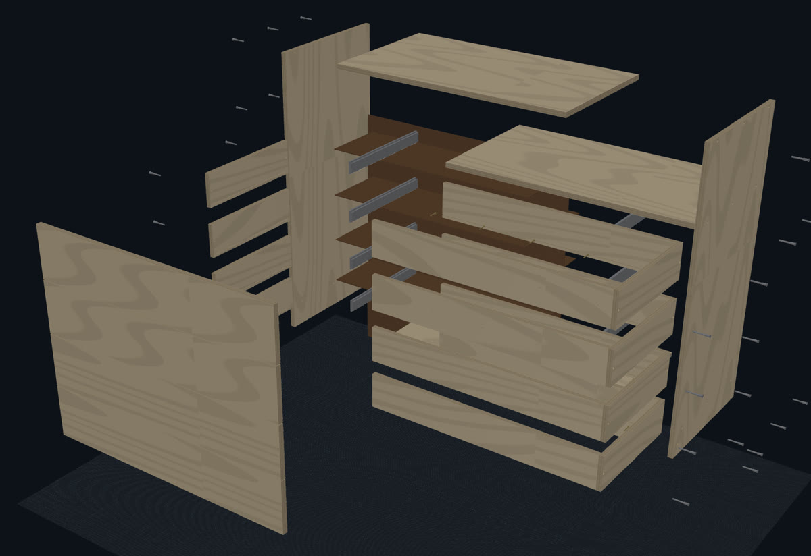

<sub>"Build a plywood chest of drawers, 900 wide, four drawers."</sub>

Anything you can describe, at its real size, down to the pieces it is made of. Furniture you can actually build, with its cut list, hardware list and assembly order; a bracket for your shelf, or a Raspberry Pi case with standoffs on its mounting holes and cutouts for its ports. Print it at true size, or keep it as an OpenSCAD program you go on editing.

### Game items


<sub>"A longsword, a mage's staff, a shield and a bow" · "a revolver, a pulse rifle, a railgun and a vibroblade."</sub>

The gear a hero carries: swords, staffs, shields and bows, in a historical, elven or dwarven style; handguns, rifles, shotguns and knives, modern or from the near and far future, in the finish you name. The vehicles they drive: karts, supercars and race machines, aircraft and boats, trains, walking mecha. The props that fill a level. Every item comes ready for a hero's hand or a level's floor. More: [flight](docs/flight-games.md).

### Characters

Heroes in a realistic, cartoon or anime look, with faces that act. Hair, clothes, armour, shoes and the gear they carry, all fitted to the body. Named heroes with their emblems, enemy crews, and animals mid-stride. Every character comes rigged and animated, ready for a game or for your 3D tools. More: [the realistic body](docs/realistic-body.md), [garments](docs/garment-principles.md), [armour](docs/plating.md).

### Environments and levels


<sub>"We just moved in, here's our floor plan! Some ideas for how we could live in it?"</sub>

**Rooms.** Send a picture of your floor plan and you get your house, built to the inch, each room designed in a style, a palette and furniture at true size, with the walkways kept clear. Ask for sage green walls and you see the room before and after.

**Interiors, planned before they are built.** Ask for a facility, say a military base with a hangar, barracks, an armoury and a reactor plant at its heart, each unlike the last, and you see the plan first: the way in from level to level, and each level's walls, floors, paint and light as the build will lay them. Nothing is built until you say yes.

| | |
|---|---|
| 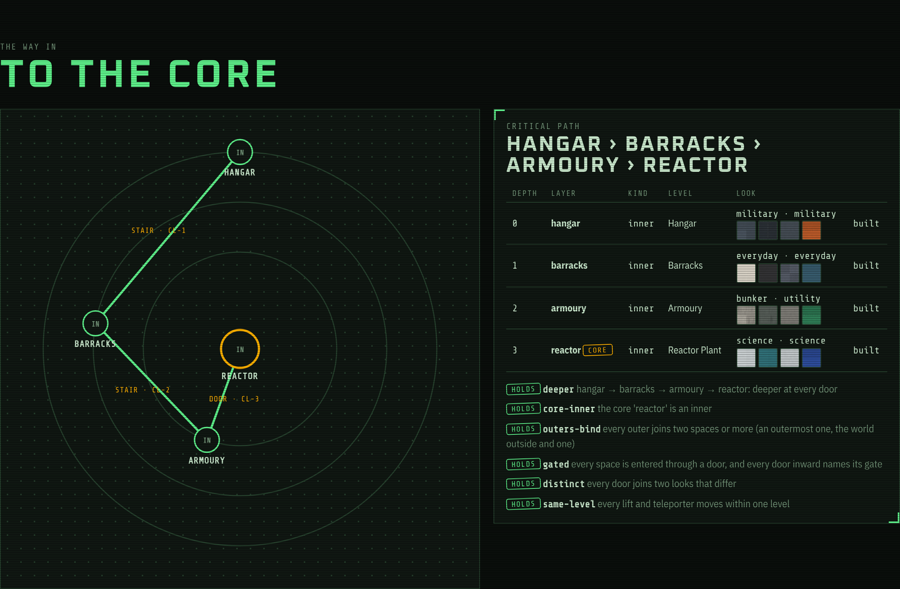 | 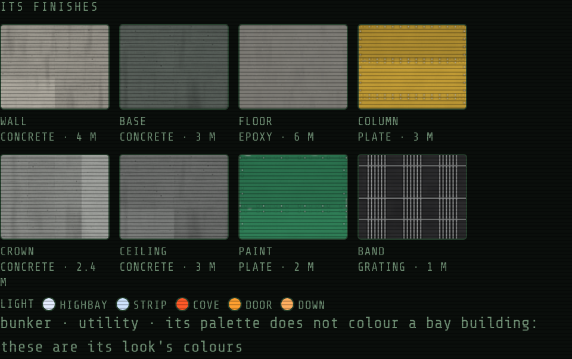 |

<sub>The plan you approve: the way in, level by level, and one level's materials and light.</sub>

Then it is built to that plan, each level in its own materials, and stocked for what it is: bunks and footlockers in the barracks, weapon racks in the armoury, sandbags at the guard posts, an extinguisher by every door.

| | |
|---|---|
| 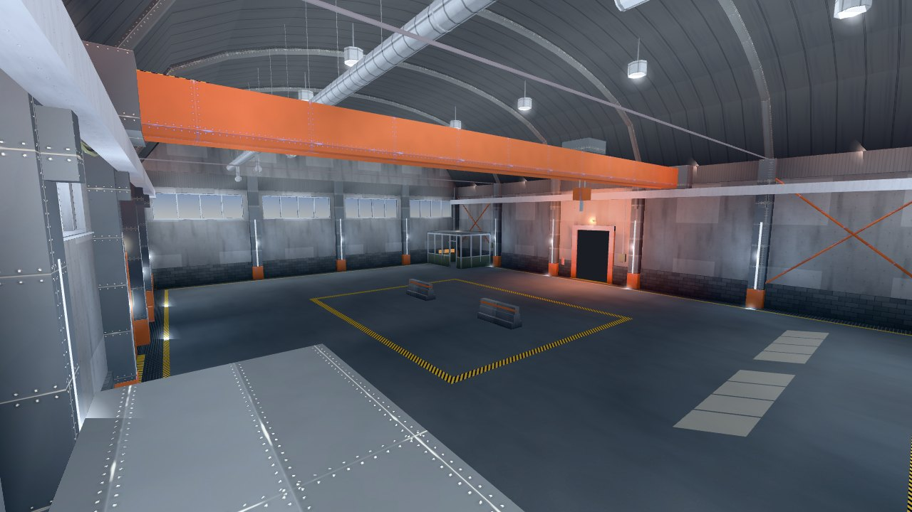 | 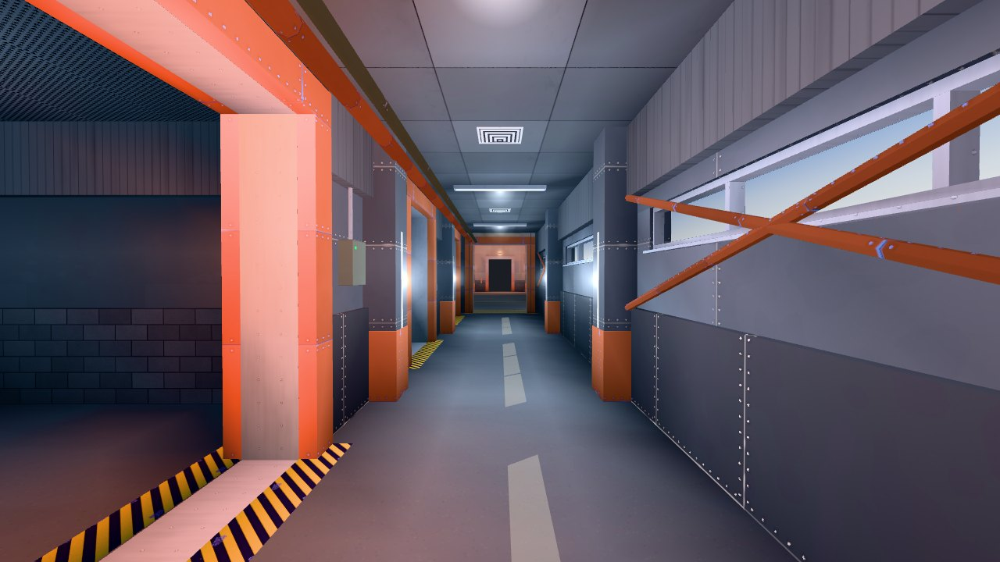 |
| 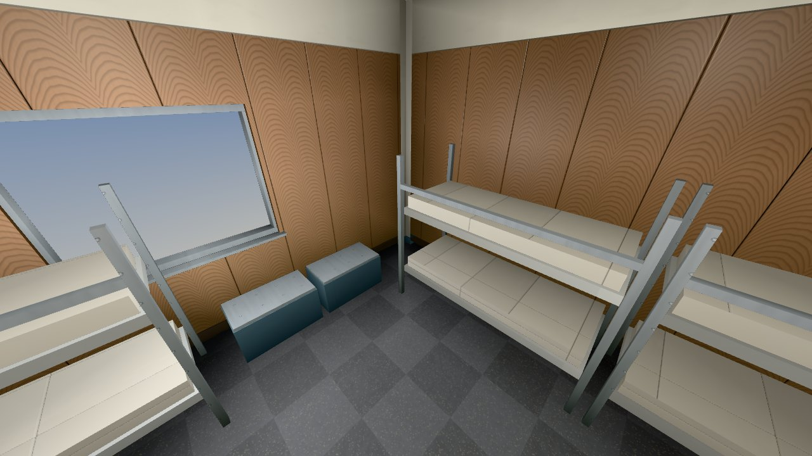 | 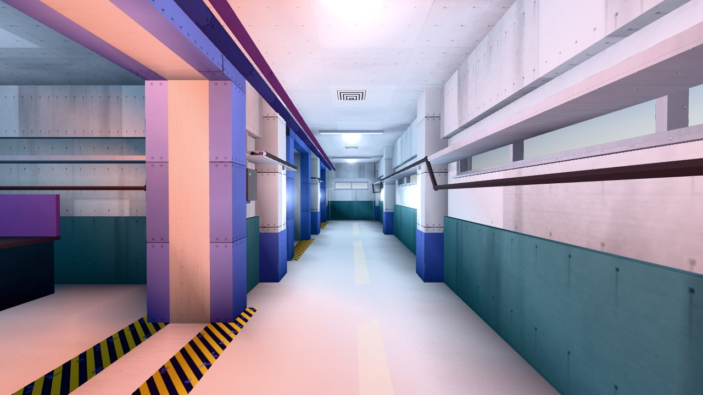 |
| 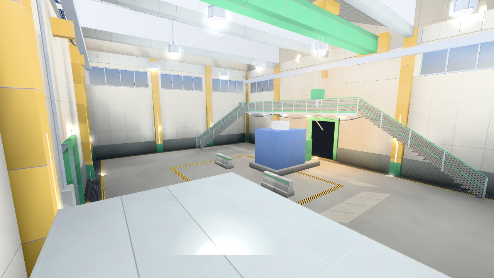 | 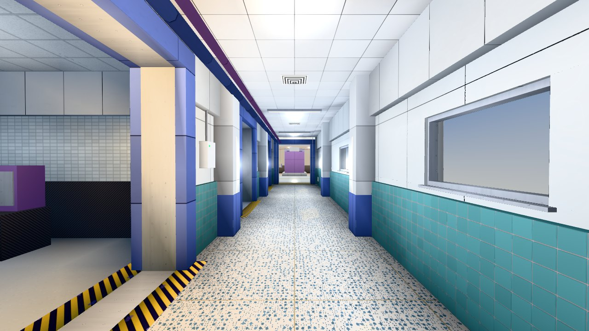 |

<sub>"I'm making a stealth game. Build me a multi-level military base to infiltrate": the hangar, the barracks, the armoury and the reactor plant, as built.</sub>

Or start from a sentence: a six-storey building with a penthouse, an office, a warehouse, a torch-lit dungeon.

**Terrain.** Grown from a sentence, with its hills, rock, water, grass and trees, at any hour of the day. Choose how real it looks, from the painted look of a sixth-generation console game to the grass, leaves and textured rock of a seventh. Rock, sand or snow underfoot; caverns, islands, planets, a historic city in its period ([docs/historic/README.md](docs/historic/README.md)), cities at real scale in the style of New York, Paris, London or Tokyo. Ask for the same place again and you get the same place, on any machine.

| | |
|---|---|
| 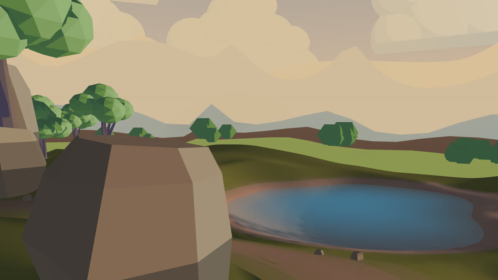 | 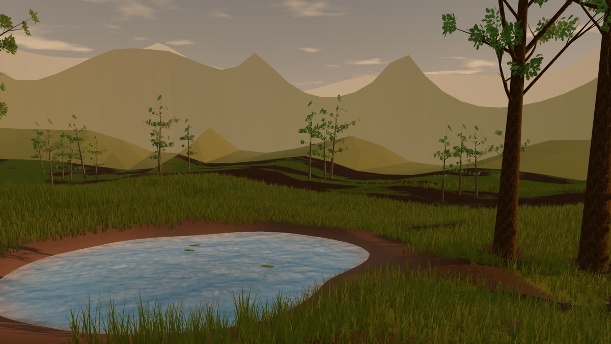 |

<sub>"A lake in the hills at sunset," in a sixth-generation look and a seventh.</sub>

### Interactive worlds

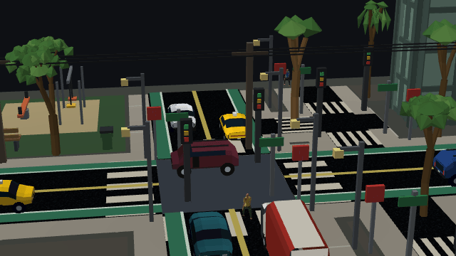

Worlds you walk through in the browser, with traffic and people on the streets, day or night. Give them music and sound: a score and sound effects made from scratch, with no samples. Film them: flythroughs, a walkthrough of your rooms, and cutscenes with actors who play a role from a script, talk to each other and hit their marks, shot the way a director would cover them. More: [cinematics](docs/cinematics.md).

### Playable games

Ask for a game and you get one you can play: its levels, its hero, its enemies, how it plays and sounds, its cutscenes. You see the plan first and approve it. Stealth, racing, shooters, flight, fighting, rhythm, sports, board and strategy games, and a pen-and-paper RPG with its printed game book. Controls that feel right, enemies from grunts to a boss at the end, and two to four players on one screen. Every level is played through to its win before you get it.

It plays in the browser as it is, or as a desktop app that runs offline. For a team, its levels and assets open in Godot, Unity, Unreal or Blender, and handing it over again after a change keeps the team's own work in the scene. More: [foes](docs/foes.md), [local multiplayer](docs/local-multiplayer-principles.md), [the table RPG](docs/table-rpg.md), [sports broadcasts](docs/broadcast.md).

**Also:** a science world, a room's layout from a photo, a picture of anything you are making from any angle. More in [docs/tour.md](docs/tour.md).

---

## Take it with you

| | What you get |
|---|---|
| **Play it** | A game in a folder for any web host, or a desktop app that runs offline. Any world opens in the browser to walk around. |
| **Open it in your engine** | A Godot 4, Unity 6, Unreal 5 or Blender project: each level's materials, light, sky, markers and cameras. |
| **Use it in 3D tools** | `.glb` with rigs and animation, and OpenUSD, at true scale. |
| **Print it** | STL or 3MF at true size in millimetres, ready for your slicer. |
| **Watch and hear it** | Flythroughs, turntables and films as video; music and sound effects as audio. |

Every export says plainly what did not make the trip. Whether it looks good is your call: nothing in mojulo claims a person has looked.

## Where it runs

On your machine (macOS, Windows, Linux) you get everything: the dashboard at `localhost:3001`, your work kept under `~/.mojulo/`, and any Blender, slicer, OpenSCAD or game engine you have, picked up automatically.

In a chat app's own Linux box, nothing touches your machine. Ask for the bundle (one zip with the playable page, the 3D model, a print file and the recipe) and keep it: on most hosts the box is gone when the session ends, and the recipe rebuilds the same thing at home. A box with no MCP client: tell the agent to run `npx mojulo orient` first.

 keeps your work ·  a throwaway box (keep the bundle). Blank means not verified yet, not "does not work".

| agent | macOS | Windows | Web agent's Linux box |
|---|:-:|:-:|:-:|
| Claude Code |  |  | |
| Claude app (macOS, Windows, web, iOS) |  |  |  |
| ChatGPT (work mode; Codex) |  Codex | |  |
| Hermes Agent |  | | |
| Grok (Build; chat) |  Build | |  |
| Meta Muse (iOS, web, macOS app; one session across them) | | |  |
| Google AI Studio | | |  |

## Your work stays yours

- **Everything is on your machine**, in `~/.mojulo/`. Exports are plain files you open in anything.
- **Keep what you like.** Ask to save something and it goes into your own cookbook, a local folder you can search later by describing what you made.
- **No telemetry.** Nothing is sent to the maintainer or to an analytics service. Full list of what touches the network: [docs/tech-requirements.md](docs/tech-requirements.md#network-posture).
- **Shared recipes can carry code.** Treat one from someone else like code.

It is for one person on their own machine, reachable only from localhost; don't expose it to the internet. [SECURITY.md](SECURITY.md), [TERMS.md](TERMS.md). The open-source mojulo is and stays Apache-2.0 with no external telemetry.

## How it works

Everything you make is kept as a small recipe, not a heavy file. Your agent writes it; mojulo builds the real thing from it, the same way every time. That is why you can change anything by asking, why every place a piece shows up stays in step, and why something made in a throwaway box rebuilds the same at home. For the details: [docs/AGENT-REFERENCE.md](docs/AGENT-REFERENCE.md), [docs/tech-requirements.md](docs/tech-requirements.md), [AGENTS.md](AGENTS.md) (non-Claude hosts).

## Where the defaults come from

Mojulo's runners, functions and capabilities come from the creator's own study of game development: research drawn from interviews, and years of personal study of art direction and of how game systems are made. Claude helped translate that study and integrate it into mojulo's systems, so it works smoothly for the people using it. Everything mojulo makes is generated by its own code from the parameters in a recipe. It does not decompile games or take their assets, and it ships none. The defaults are a starting point: going beyond them takes iteration, by tuning the recipe, bringing your own references, looking at the result and revising.

## Contributing

One maintainer, no SLA. The easy contribution is a [recipe book](control/book/) entry: a folder with a card and a recipe, with no change to core. Bug reports with a pasted recipe (they reproduce exactly), correctness fixes, translations and tests are welcome; concept PRs that change how mojulo works will likely sit, and forks are the open door. Full stance: [CONTRIBUTING.md](CONTRIBUTING.md).

## License

[Apache License 2.0](LICENSE). The name is a trademark: fork freely, under your own name ([TRADEMARKS.md](TRADEMARKS.md)).
