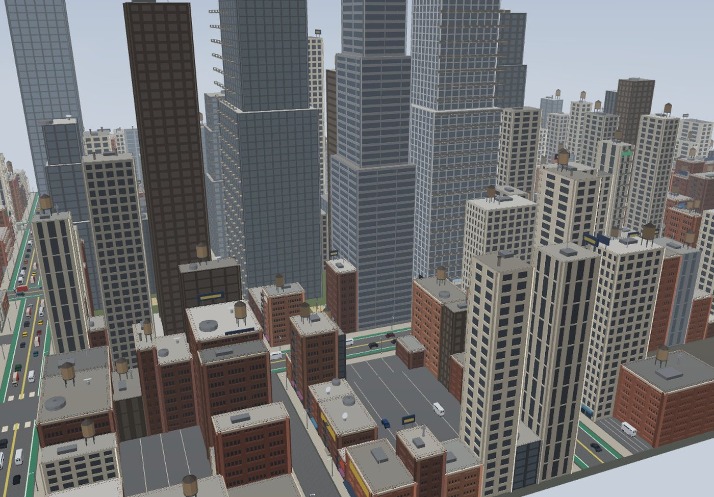
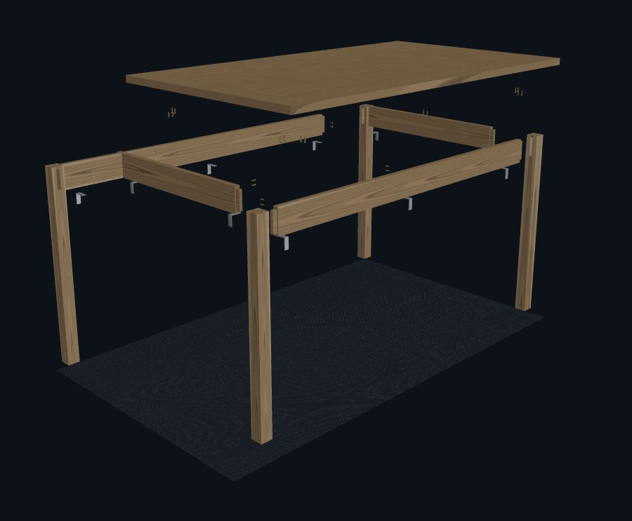
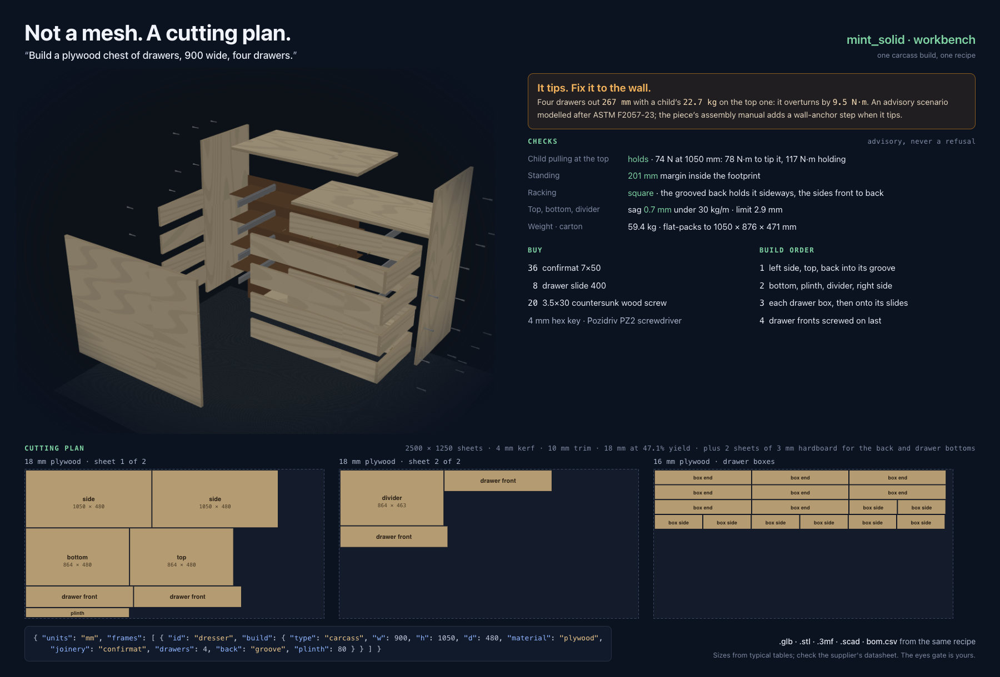

# Mojulo

[](https://www.npmjs.com/package/mojulo)
[](LICENSE)
[](control/package.json)

**A 3D creative studio for your agent.** Ask for levels, characters, vehicles, gameplay, enemies, cutscenes or music, and your agent builds them on your machine. Play them in the browser, print them, or take them into Godot, Unity, Unreal or Blender.



<sub>"Build a New York-style city at real scale."</sub>

You talk to the agent you already use: Claude Code, Codex, the Claude app, ChatGPT, or any MCP host. You bring the taste; it brings the craft. Change anything by asking, and everything that uses it changes too. No API key, no account, no telemetry.

## Get started

```bash
npx mojulo init
```

You need **Node 22.14+** and an agent that speaks MCP. `init` finds the agents on your machine, asks once for each, and opens the dashboard at `http://localhost:3001`. Then start a fresh agent session and ask for something: **"make me a hero in an anime style"**, **"build a snowy island at dusk"**, **"make me a kart racer"**. Or ask **"what is this?"** for a tour.

In Claude Code you can install the plugin instead: `/plugin marketplace add zombico/mojulo`, then `/plugin install mojulo@mojulo` ([plugins/mojulo](plugins/mojulo/README.md)). Use the plugin or `init`, not both. In ChatGPT: [Mojulo for ChatGPT](plugins/mojulo-chatgpt/README.md).

Nothing on your machine at all? In the Claude app, Grok chat, Google AI Studio or Meta Muse, tell the agent: *Open a Linux box and install the mojulo npm package in it.* In ChatGPT, say the same in work mode. [More on where it runs.](#where-it-runs)

<details>
<summary>Wire it by hand</summary>

```bash
# Claude Code (--scope user makes mojulo available in every project):
claude mcp add --scope user mojulo -- npx -y mojulo

# Codex: add to ~/.codex/config.toml
[mcp_servers.mojulo]
command = "npx"
args = ["-y", "mojulo"]
```

```jsonc
// Claude Desktop: add under "mcpServers" in claude_desktop_config.json, then restart.
// If it fails with "spawn npx ENOENT", replace "npx" with the absolute path from `which npx`.
"mojulo": { "command": "npx", "args": ["-y", "mojulo"] }
```

Open the dashboard on its own with `npx -y mojulo-ui`.

**Upgrading from 2.x?** Read [Upgrading from 2.x](control/CHANGELOG.md#upgrading-from-2x) first: an unpinned `npx mojulo` moves to 3.x on its next start, and 3.x re-encrypts saved provider keys so 2.x can no longer read them. The 2.x versions are unmaintained and have known security issues ([SECURITY.md](SECURITY.md#known-issues-in-2x)).

</details>

---

## What you can make

### Levels and worlds

| | |
|---|---|
|  |  |
|  |  |

<sub>Four levels of one military base, each with its own look: a hangar, barracks, a bunker armoury and a reactor plant.</sub>

Places to play and explore, lit and dressed: a base to sneak through, an open world across a city's districts, caverns, a torch-lit dungeon, an island at any hour of the day, a planet. Rock, sand or snow underfoot, with forests and grass growing on it. Buildings stocked for what they are: bunks and footlockers in a barracks, weapon racks in an armoury, an extinguisher by every door. Cities at real scale in the style of New York, Paris, London or Tokyo, with traffic and people on the streets. Ask for the same place again and you get the same place, on any machine. More: [walled-core dungeons](docs/walled-core-dungeon.md), [quest open worlds](docs/quest-open-world.md).


### Characters

Heroes in a realistic, cartoon or anime look, with faces that act: expressions, and a facial-capture take saved with its voice. Hair, clothes, armour, shoes and the gear they carry, all fitted to the body. Named heroes with their emblems, enemy crews, and animals mid-stride. Every character comes rigged and animated, ready for a game or for 3D tools. More: [the realistic body](docs/realistic-body.md), [garments](docs/garment-principles.md), [armour](docs/plating.md).

### Vehicles and props

Karts, supercars and race machines, aircraft and boats, trains, walking mecha; the props that fill a level, and the weapons and gear a hero carries. More: [flight](docs/flight-games.md).

### Gameplay

How a game plays: stealth, racing, shooters, flight, fighting, rhythm, sports, board and strategy games, and a pen-and-paper RPG with its printed game book. Controls that feel right, moves and hit effects, and two to four players on one screen. Every level is played through to its win before you get it, so you never receive a race that cannot be finished. More: [local multiplayer](docs/local-multiplayer-principles.md), [the table RPG](docs/table-rpg.md), [sports broadcasts](docs/broadcast.md).

### Enemies and bosses

Who stands in each level and how hard they fight: grunts, harriers, elites and a boss at the end, each with its own attack, from wind-up to recovery. Enemy crews, beasts and oozes in your game's look. More: [foes](docs/foes.md).

### Cutscenes and film

Actors who play a role from a script, talk to each other, listen, and hit their marks. A boss's entrance, an arrival, two characters talking, shot the way a director would cover them. Flythroughs and recorded runs joined into a video. A picture of anything you are making, from any angle. More: [cinematics](docs/cinematics.md).

### Music and sound

A score and sound effects, made from scratch with no samples: an ambient loop for a level, a full track, the hits and pickups of a game.

### Rooms, furniture and things to print


<sub>"We just moved in, here's our floor plan! Some ideas for how we could live in it?"</sub>

Send a picture of your floor plan and you get your house, built to the inch, with each room designed in a style, a palette and furniture at true size, walkways kept clear. Ask for sage green walls and you see the room before and after.

| | |
|---|---|
|  |  |

Furniture you can build, pulled apart to show how it goes together, with its cut list, hardware list and assembly order. Parts you can print at true size, like a Raspberry Pi case with standoffs on its mounting holes and cutouts for its ports, or written as an OpenSCAD program you keep editing.

**Also:** a six-storey building with a penthouse, an office or a warehouse from a brief, a historic city in its period ([docs/historic/README.md](docs/historic/README.md)), a science world, a room's layout from a photo. More in [docs/tour.md](docs/tour.md).

---

## Make it a game

Ask for a game and the pieces come together as one: its levels, its hero, its enemies, how it plays and sounds, and its cutscenes. You see the plan first and approve it. You get a game that plays in the browser as it is, or as a desktop app that runs offline. For a team, the same levels and assets go to Godot, Unity, Unreal or Blender as a project the engine opens, and handing it over again after a change keeps the team's own work in the scene.

## Take it with you

| | What you get |
|---|---|
| **Play it** | A game in a folder for any web host, or a desktop app that runs offline. Any world opens in the browser to walk around. |
| **Open it in your engine** | A Godot 4, Unity 6, Unreal 5 or Blender project: each level's materials, light, sky, markers and cameras. |
| **Use it in 3D tools** | `.glb` with rigs and animation, and OpenUSD, at true scale. |
| **Print it** | STL or 3MF at true size in millimetres, ready for your slicer. |
| **Watch and hear it** | Flythroughs, turntables and films as video; music and sound effects as audio. |

Every export says plainly what did not make the trip. Whether it looks good is your call: nothing in mojulo claims a person has looked.

## Where it runs

On your machine (macOS, Windows, Linux) you get everything: the dashboard at `localhost:3001`, your work kept under `~/.mojulo/`, and any Blender, slicer, OpenSCAD or game engine you have, picked up automatically.

In a chat app's own Linux box, nothing touches your machine. Ask for the bundle (one zip with the playable page, the 3D model, a print file and the recipe) and keep it: on most hosts the box is gone when the session ends, and the recipe rebuilds the same thing at home. A box with no MCP client: tell the agent to run `npx mojulo orient` first.

 keeps your work ·  a throwaway box (keep the bundle). Blank means not verified yet, not "does not work".

| agent | macOS | Windows | Web agent's Linux box |
|---|:-:|:-:|:-:|
| Claude Code |  |  | |
| Claude app (macOS, Windows, web, iOS) |  |  |  |
| ChatGPT (work mode; Codex) |  Codex | |  |
| Hermes Agent |  | | |
| Grok (Build; chat) |  Build | |  |
| Meta Muse (iOS, web, macOS app; one session across them) | | |  |
| Google AI Studio | | |  |

## Your work stays yours

- **Everything is on your machine**, in `~/.mojulo/`. Exports are plain files you open in anything.
- **Keep what you like.** Ask to save something and it goes into your own cookbook, a local folder you can search later by describing what you made.
- **No telemetry.** Nothing is sent to the maintainer or to an analytics service. Full list of what touches the network: [docs/tech-requirements.md](docs/tech-requirements.md#network-posture).
- **Shared recipes can carry code.** Treat one from someone else like code.

It is for one person on their own machine, reachable only from localhost; don't expose it to the internet. [SECURITY.md](SECURITY.md), [TERMS.md](TERMS.md). The open-source mojulo is and stays Apache-2.0 with no external telemetry.

## How it works

Everything you make is kept as a small recipe, not a heavy file. Your agent writes it; mojulo builds the real thing from it, the same way every time. That is why you can change anything by asking, why every place a piece shows up stays in step, and why something made in a throwaway box rebuilds the same at home. For the details: [docs/AGENT-REFERENCE.md](docs/AGENT-REFERENCE.md), [docs/tech-requirements.md](docs/tech-requirements.md), [AGENTS.md](AGENTS.md) (non-Claude hosts).

## Where the defaults come from

Mojulo's runners, functions and capabilities come from the creator's own study of game development: research drawn from interviews, and years of personal study of art direction and of how game systems are made. Claude helped translate that study and integrate it into mojulo's systems, so it works smoothly for the people using it. Everything mojulo makes is generated by its own code from the parameters in a recipe. It does not decompile games or take their assets, and it ships none. The defaults are a starting point: going beyond them takes iteration, by tuning the recipe, bringing your own references, looking at the result and revising.

## Contributing

One maintainer, no SLA. The easy contribution is a [recipe book](control/book/) entry: a folder with a card and a recipe, with no change to core. Bug reports with a pasted recipe (they reproduce exactly), correctness fixes, translations and tests are welcome; concept PRs that change how mojulo works will likely sit, and forks are the open door. Full stance: [CONTRIBUTING.md](CONTRIBUTING.md).

## License

[Apache License 2.0](LICENSE). The name is a trademark: fork freely, under your own name ([TRADEMARKS.md](TRADEMARKS.md)).
