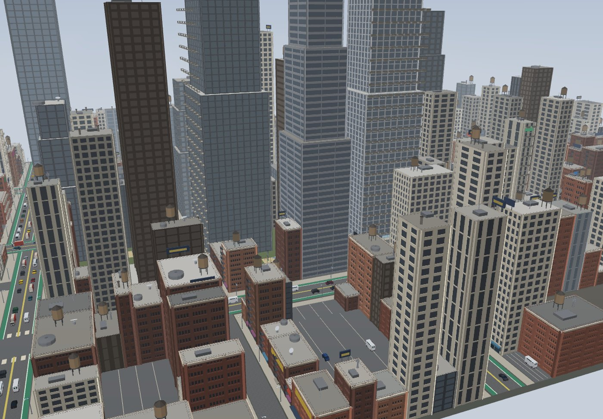
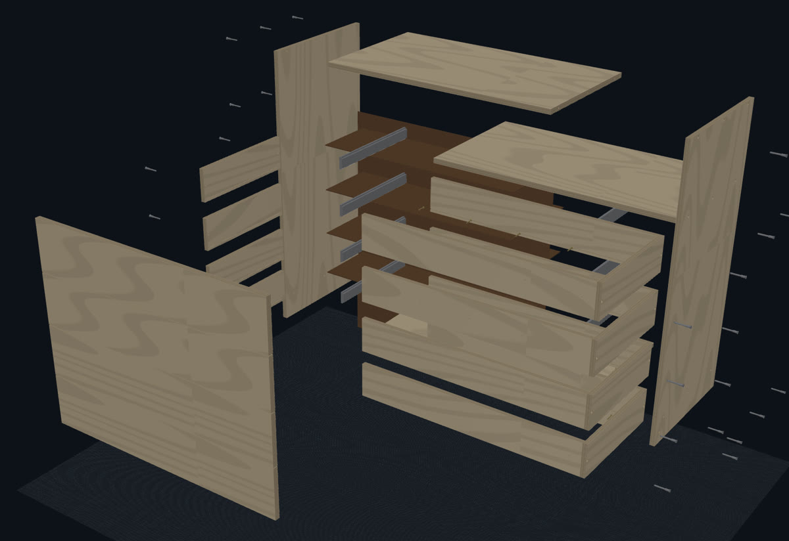
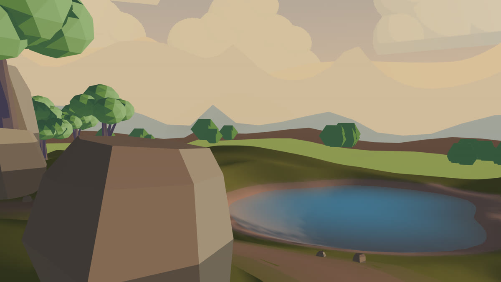
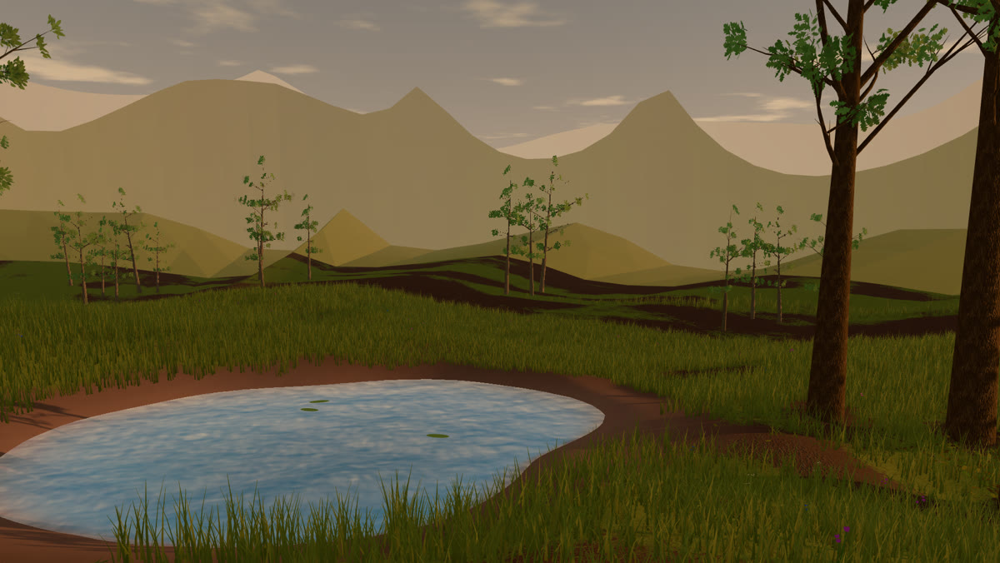

# Mojulo

[](https://www.npmjs.com/package/mojulo)
[](LICENSE)
[](control/package.json)

**A 3D creative studio for your agent.** Make 3D objects, characters, environments, interactive worlds and even playable games, just by asking, and take them to your desktop: play them, print them, or open them in Godot, Unity, Unreal or Blender.



<sub>"Build a New York-style city at real scale."</sub>

You talk to the agent you already use: Claude Code, Codex, the Claude app, ChatGPT, or any MCP host. You bring the taste; it brings the craft. Change anything by asking, and everything that uses it changes too. No API key, no account, no telemetry.

## Get started

**In Claude Code**, add the plugin:

```
/plugin marketplace add zombico/mojulo
/plugin install mojulo@mojulo
```

Claude Code installs mojulo itself, and the plugin adds a skill for each way in ([plugins/mojulo](plugins/mojulo/README.md)). In the Claude app it is under **Customize > Plugins**.

**Any other agent** (Codex, Claude Desktop, Hermes, any MCP host):

```bash
npx mojulo init
```

You need **Node 22.14+**. `init` finds the agents on your machine, asks once for each, and opens the dashboard at `http://localhost:3001`. Use the plugin or `init`, not both. In ChatGPT: [Mojulo for ChatGPT](plugins/mojulo-chatgpt/README.md).

Then start a fresh agent session and ask for something: **"build a plywood chest of drawers"**, **"a longsword and a shield"**, **"a lake in the hills at sunset"**, **"make me a kart racer"**. Or ask **"what is this?"** for a tour: with nothing in mind yet, it offers five ways to start (a character, a game, an object, a 3D exhibit, or a home or a room).

Nothing on your machine at all? In the Claude app, Grok chat, Google AI Studio or Meta Muse, tell the agent: *Open a Linux box and install the mojulo npm package in it.* In ChatGPT, say the same in work mode. [More on where it runs.](#where-it-runs)

<details>
<summary>Wire it by hand</summary>

```bash
# Claude Code without the plugin (--scope user makes mojulo available in every project):
claude mcp add --scope user mojulo -- npx -y mojulo

# Codex: add to ~/.codex/config.toml
[mcp_servers.mojulo]
command = "npx"
args = ["-y", "mojulo"]
```

```jsonc
// Claude Desktop: add under "mcpServers" in claude_desktop_config.json, then restart.
// If it fails with "spawn npx ENOENT", replace "npx" with the absolute path from `which npx`.
"mojulo": { "command": "npx", "args": ["-y", "mojulo"] }
```

Open the dashboard on its own with `npx -y mojulo-ui`.

</details>

## How a session goes

- **Say what you want, or pick a start.** A thing asked for plainly is made at once.
- **Bring what you have.** Sketches, a floor plan, a document, a photo, lore, rules, a 3D model you already own. Each one is used, or you are told why it was set aside; nothing is quietly dropped, and you are not asked again what it already said.
- **For a game, a home or an exhibit, a few questions first.** One at a time, only what you alone can answer, then it says back what it will make before it makes anything.
- **Look, play, change it by asking.** Everything that uses what you changed changes with it.

---

## What you can make

Start small and go as far as you like: an object, the gear a hero carries, the hero, a place to put them in, a world that moves, a game to play in it.

### 3D objects



<sub>"Build a plywood chest of drawers, 900 wide, four drawers."</sub>

Anything you can describe, at its real size, down to the pieces it is made of: furniture you can build, with its cut list, hardware and assembly order; a bracket for your shelf; a Raspberry Pi case. Print it at true size, or keep it as an OpenSCAD program you go on editing.

### Game items


<sub>"A longsword, a mage's staff, a shield and a bow" · "a revolver, a pulse rifle, a railgun and a vibroblade."</sub>

Swords, staffs, shields and bows in a historical, elven or dwarven style; guns and knives, modern or from the future, in the finish you name. Karts, supercars, aircraft, spacecraft, boats, trains and walking mecha. The props that fill a level.

### Characters

Heroes in a realistic, cartoon or anime look, with faces that act; hair, clothes, armour and gear fitted to the body; creatures and animals mid-stride. Every character comes rigged and animated, ready for a game or your 3D tools. Bring a model of your own (GLB, VRM, glTF, OBJ, STL) and it is read, measured and rigged as a body or a mascot. More: [the realistic body](docs/realistic-body.md), [garments](docs/garment-principles.md).

### Homes and rooms


<sub>"We just moved in, here's our floor plan! Some ideas for how we could live in it?"</sub>

A room to redo, the home you moved into, a house from nothing, a shop or a café to fit out. Send a picture of your floor plan and you get your house built to the inch, each room designed in a style and a palette with furniture at true size. Ask for sage green walls and you see the room before and after. Bigger buildings are planned before they are built: a multi-level base, an office, a torch-lit dungeon ([the long tour](docs/tour.md#a-facility-planned-before-it-is-built) shows one).

### Worlds

| | |
|---|---|
|  |  |

<sub>"A lake in the hills at sunset," in a sixth-generation look and a seventh.</sub>

Terrain from a sentence, from the painted look of a sixth-generation console game to the grass, leaves and rock of a seventh; caverns, islands, planets; a historic city in its period; cities at real scale in the style of New York, Paris, London or Tokyo. Walk them in the browser, and turn on destruction: glass shatters, brick blasts apart, and what loses its support comes down under its own weight. Give them a score and sound made from scratch, and film them: flythroughs and cutscenes with actors who play a role from a script. More: [destructible environments](docs/rupa.md), [cinematics](docs/cinematics.md).

### 3D exhibits

A concept to show a class or a gallery, fitted to who comes and how long they have: one exhibit, a guided tour, or a gallery of rooms. Science demos run on real laws; your knowledge stays yours, and nothing is claimed for you.

---

## Games: from an idea to a first level you play

Bring an idea, a sketch, a map or a design document. In one session the agent takes it to a first level: who is in it, what the player does again and again, the level built, how it feels. Every level is played through to its win by the machine before you get it; whether it is the game you want is yours to say, by playing it.

- **Start from a kind of game you know.** A platformer, a side-scrolling run and gun or beat-em-up, a metroidvania, a party RPG or an action RPG, a stealth mission, a first-person or arena shooter, flight and space combat, mech action, racing, fighting, sports, rhythm, puzzle, farming, tower defence, strategy, a board game, a pen-and-paper RPG with its printed game book. It is a template; the game is yours. [What can be made today](docs/tool-surface/hillclimb.md#the-genre-probes).
- **Or say it in one sentence** and get a whole first game to change: "a split screen deathmatch for four friends", "a stealth game: sneak past the guards to reach the exit".
- **It comes as a game:** a start screen, menus, a HUD, pause, results between levels and the next level after. Enemies from grunts to a boss; two to four players on one screen or split screen.
- **Take it where you need it.** Play it in the browser, ship it to the web or as a desktop app that runs offline. For a team, its levels, characters and animation open in Godot, Unity, Unreal or Blender, and handing it over again after a change keeps the team's own work in the scene.

More: [from nothing to a first level](docs/zero-to-level-one.md), [foes](docs/foes.md), [local multiplayer](docs/local-multiplayer-principles.md).

---

## Take it with you

| | What you get |
|---|---|
| **Play it** | A game in a folder for any web host, or a desktop app that runs offline. Any world opens in the browser to walk around. |
| **Open it in your engine** | A Godot 4, Unity 6, Unreal 5 or Blender project: each level's materials, light, sky, markers and cameras. |
| **Use it in 3D tools** | `.glb` with rigs and animation, and OpenUSD, at true scale. |
| **Print it** | STL or 3MF at true size in millimetres, ready for your slicer. |
| **Watch and hear it** | Flythroughs, turntables and films as video; music and sound effects as audio. |

Every export says plainly what did not make the trip. Whether it looks good is your call: nothing in mojulo claims a person has looked.

## Where it runs

On your machine (macOS, Windows, Linux) you get everything: the dashboard at `localhost:3001`, your work kept under `~/.mojulo/`, and any Blender, slicer, OpenSCAD or game engine you have, picked up automatically.

In a chat app's own Linux box, nothing touches your machine. Ask for the bundle (one zip with the playable page, the 3D model, a print file and the recipe) and keep it: on most hosts the box is gone when the session ends, and the recipe rebuilds the same thing at home. A box with no MCP client: tell the agent to run `npx mojulo orient` first.

 keeps your work ·  a throwaway box (keep the bundle). Blank means not verified yet, not "does not work".

| agent | macOS | Windows | Web agent's Linux box |
|---|:-:|:-:|:-:|
| Claude Code |  |  | |
| Claude app (macOS, Windows, web, iOS) |  |  |  |
| ChatGPT (work mode; Codex) |  Codex | |  |
| Hermes Agent |  | | |
| Grok (Build; chat) |  Build | |  |
| Meta Muse (iOS, web, macOS app; one session across them) | | |  |
| Google AI Studio | | |  |

## Your work stays yours

- **Everything is on your machine**, in `~/.mojulo/`. Exports are plain files you open in anything.
- **Keep what you like.** Ask to save something and it goes into your own cookbook, a local folder you can search later by describing what you made.
- **No telemetry.** Nothing is sent to the maintainer or to an analytics service. Full list of what touches the network: [docs/tech-requirements.md](docs/tech-requirements.md#network-posture).
- **Shared recipes can carry code.** Treat one from someone else like code.

It is for one person on their own machine, reachable only from localhost; don't expose it to the internet. [SECURITY.md](SECURITY.md), [TERMS.md](TERMS.md). The open-source mojulo is and stays Apache-2.0 with no external telemetry.

## How it works

Everything you make is kept as a small recipe, not a heavy file. Your agent writes it; mojulo builds the real thing from it, the same way every time. That is why you can change anything by asking, why every place a piece shows up stays in step, and why something made in a throwaway box rebuilds the same at home. For the details: [docs/AGENT-REFERENCE.md](docs/AGENT-REFERENCE.md), [docs/tech-requirements.md](docs/tech-requirements.md), [AGENTS.md](AGENTS.md) (non-Claude hosts).

**Upgrading from 2.x?** Read [Upgrading from 2.x](control/CHANGELOG.md#upgrading-from-2x) first: an unpinned `npx mojulo` moves to 3.x on its next start, and 3.x re-encrypts saved provider keys so 2.x can no longer read them. The 2.x versions are unmaintained and have known security issues ([SECURITY.md](SECURITY.md#known-issues-in-2x)).

## Where the defaults come from

Mojulo's runners, functions and capabilities come from the creator's own study of game development: research drawn from interviews, and years of personal study of art direction and of how game systems are made. Claude helped translate that study and integrate it into mojulo's systems, so it works smoothly for the people using it. Everything mojulo makes is generated by its own code from the parameters in a recipe. It does not decompile games or take their assets, and it ships none. The defaults are a starting point: going beyond them takes iteration, by tuning the recipe, bringing your own references, looking at the result and revising.

## Contributing

One maintainer, no SLA. The easy contribution is a [recipe book](control/book/) entry: a folder with a card and a recipe, with no change to core. Bug reports with a pasted recipe (they reproduce exactly), correctness fixes, translations and tests are welcome; concept PRs that change how mojulo works will likely sit, and forks are the open door. Full stance: [CONTRIBUTING.md](CONTRIBUTING.md).

## License

[Apache License 2.0](LICENSE). The name is a trademark: fork freely, under your own name ([TRADEMARKS.md](TRADEMARKS.md)).
