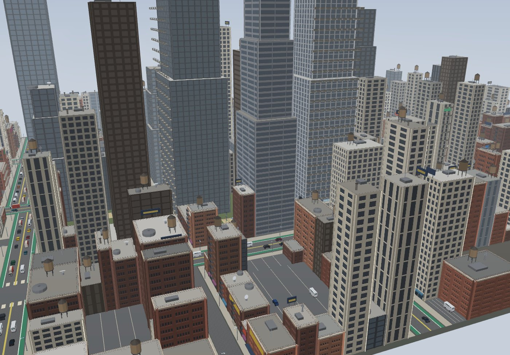

# Mojulo

**A 3D creative studio for your agent.** Make 3D objects, characters, environments, interactive worlds and even playable games, just by asking, and take them to your desktop: play them, print them, or open them in Godot, Unity, Unreal or Blender.



<sub>"Build a New York-style city at real scale."</sub>

You talk to the agent you already use: Claude Code, Codex, the Claude app, ChatGPT, or any MCP host. You bring the taste; it brings the craft. Change anything by asking, and everything that uses it changes too. No API key, no account, no telemetry.

## Get started

**In Claude Code**, add the plugin: `/plugin marketplace add zombico/mojulo`, then `/plugin install mojulo@mojulo`. Claude Code installs mojulo itself, and the plugin adds a skill for each way in ([the plugin](https://github.com/zombico/mojulo/tree/main/plugins/mojulo)). In the Claude app it is under **Customize > Plugins**.

**Any other agent** (Codex, Claude Desktop, Hermes, any MCP host):

```bash
npx mojulo init
```

You need **Node.js 22.14+** ([nodejs.org](https://nodejs.org), or ask your agent to install it). `init` finds the agents on your machine, asks once for each, and opens the dashboard. Use the plugin or `init`, not both. In ChatGPT: [Mojulo for ChatGPT](https://github.com/zombico/mojulo/tree/main/plugins/mojulo-chatgpt).

Then start a fresh session and ask:

```
build a plywood chest of drawers, 900 wide, four drawers
a longsword, a shield and a bow
make me a hero in an anime style
a lake in the hills at sunset
here's our floor plan, some ideas for living in it?
build a New York-style city at real scale
make me a kart racer
what is this?
```

With nothing in mind yet, ask "what is this?": it offers five ways to start (a character, a game, an object, a 3D exhibit, or a home or a room).

Nothing on your machine at all? In the Claude app, Grok chat, Google AI Studio or Meta Muse, tell the agent: *Open a Linux box and install the mojulo npm package in it.* In ChatGPT, say the same in work mode. Ask for the bundle on the way out (one zip with the playable page, the 3D model, a print file and the recipe) and keep it: the recipe rebuilds the same thing on your own machine. A box with no MCP client: tell the agent to run `npx mojulo orient` first.

<details>
<summary>Wire it by hand</summary>

```bash
# Claude Code without the plugin:
claude mcp add --scope user mojulo -- npx -y mojulo

# Codex CLI: add to ~/.codex/config.toml
[mcp_servers.mojulo]
command = "npx"
args = ["-y", "mojulo"]

# Claude Desktop: add under "mcpServers" in claude_desktop_config.json, then restart it
"mojulo": { "command": "npx", "args": ["-y", "mojulo"] }

# Claude Code on the web, a Codex cloud task: no one at the keyboard
npx -y mojulo init --yes --no-ui
```

Other MCP hosts: register the same `npx -y mojulo` stdio command.

</details>

## How a session goes

- **Say what you want, or pick a start.** A thing asked for plainly is made at once.
- **Bring what you have.** Sketches, a floor plan, a document, a photo, lore, rules, a 3D model you already own. Each one is used, or you are told why it was set aside; nothing is quietly dropped.
- **For a game, a home or an exhibit, a few questions first.** One at a time, only what you alone can answer, then it says back what it will make before it makes anything.
- **Look, play, change it by asking.** Everything that uses what you changed changes with it.

## What you can make

Start small and go as far as you like.

- **3D objects.** Anything you can describe, at its real size, down to the pieces it is made of: a chest of drawers you can build, with its cut list, hardware list and assembly order; a bracket for your shelf; a Raspberry Pi case. Print it at true size as STL or 3MF.
- **Game items.** Swords, staffs, shields and bows in a historical, elven or dwarven style; guns and knives, modern or from the future; karts, supercars, aircraft, spacecraft, boats, trains and walking mecha; the props that fill a level.
- **Characters.** Heroes in a realistic, cartoon or anime look, with faces that act; hair, clothes, armour and gear fitted to the body; creatures and animals mid-stride. Rigged and animated. Bring a model of your own and it is rigged as a body or a mascot.
- **Homes and rooms.** A room to redo, your house from a picture of its floor plan built to the inch, a house from nothing, a shop or a café, each room designed with furniture at true size.
- **Worlds.** Terrain from a sentence in the look of a sixth- or seventh-generation console game, a historic city in its period, cities at real scale in the style of New York, Paris, London or Tokyo. Walk them in the browser, break them, score them and film them.
- **3D exhibits.** A concept to show a class or a gallery, fitted to who comes and how long they have.

## Games: from an idea to a first level you play

Bring an idea, a sketch, a map or a design document. In one session the agent takes it to a first level: who is in it, what the player does again and again, the level built, how it feels. Every level is played through to its win by the machine before you get it; whether it is the game you want is yours to say, by playing it.

- **Start from a kind of game you know:** a platformer, a side-scrolling run and gun or beat-em-up, a metroidvania, a party or action RPG, a stealth mission, a first-person or arena shooter, flight and space combat, mech action, racing, fighting, sports, rhythm, puzzle, farming, tower defence, strategy, a board game, a pen-and-paper RPG. It is a template; the game is yours.
- **Or say it in one sentence** and get a whole first game to change.
- **It comes as a game:** a start screen, menus, a HUD, pause, results and the next level. Enemies from grunts to a boss; two to four players on one screen or split screen.
- **Ship it** to the web or as a desktop app that runs offline, or hand its levels, characters and animation to a team's Godot, Unity, Unreal or Blender project.

## Take it with you

- **Play it** in the browser, as a game folder for any web host, or as a desktop app that runs offline.
- **Open it in your engine:** a Godot 4, Unity 6, Unreal 5 or Blender project with each level's materials, light, markers and cameras. Hand it over again after a change and your team's own work in the scene is kept.
- **Use it in 3D tools:** `.glb` with rigs and animation, and OpenUSD, at true scale.
- **Print it:** STL or 3MF at true size in millimetres, ready for your slicer.
- **Watch and hear it:** flythroughs, turntables and films as video; music and sound effects as audio.

Every export says plainly what did not make the trip. Whether it looks good is your call: nothing in mojulo claims a person has looked.

## Where it runs

On your machine (macOS, Windows, Linux) you get everything: the dashboard, your work kept under `~/.mojulo/`, and any Blender, slicer, OpenSCAD or game engine you have, picked up automatically. In a chat app's Linux box nothing touches your machine; keep the bundle.

Where it has been run.  keeps your work ·  a throwaway box (keep the bundle). Blank means not verified yet, not "does not work".

| agent | macOS | Windows | Web agent's Linux box |
|---|:-:|:-:|:-:|
| Claude Code |  |  | |
| Claude app (macOS, Windows, web, iOS) |  |  |  |
| ChatGPT (work mode; Codex) |  Codex | |  |
| Hermes Agent |  | | |
| Grok (Build; chat) |  Build | |  |
| Meta Muse (iOS, web, macOS app; one session across them) | | |  |
| Google AI Studio | | |  |

**Upgrading from 2.x?** Read [Upgrading from 2.x](https://github.com/zombico/mojulo/blob/main/control/CHANGELOG.md#upgrading-from-2x) first: an unpinned `npx mojulo` moves to 3.x on its next start, and 3.x re-encrypts saved provider keys so 2.x can no longer read them. The 2.x versions are unmaintained and have known security issues ([SECURITY.md](https://github.com/zombico/mojulo/blob/main/SECURITY.md#known-issues-in-2x)).

## Dashboard

```bash
npx -y mojulo-ui                # opens in your browser
npx -y mojulo-ui --port 3999    # pin the port
npx -y mojulo-ui --no-open      # don't open the browser
```

Browse everything you have made, walk your worlds, play your games in the Arcade, and review films, music and voices. You make things by asking your agent; the dashboard shows them. It ships in every language under `messages/`, right-to-left scripts included (**Settings → Language**).

## Command line

The same `mojulo` command works without an agent, for spot checks and scripts: `npx mojulo tools`, `npx mojulo help <tool>`, `npx mojulo call <tool>`.

## Your work stays yours

Everything lives on your machine in `~/.mojulo/`, and exports are plain files you open in anything. Ask to save something and it goes into your own cookbook, a local folder you can search later by describing what you made. Nothing is sent to the maintainer or to an analytics service ([what touches the network](https://github.com/zombico/mojulo/blob/main/docs/tech-requirements.md#network-posture)). It is for one person on their own machine, reachable only from localhost. Shared recipes can carry code: treat one from someone else like code.

What you make today rebuilds the same tomorrow: new releases add to what mojulo can make and never change what you already made. See the [changelog](https://github.com/zombico/mojulo/blob/main/control/CHANGELOG.md).

## More

- Full repo and docs: <https://github.com/zombico/mojulo>
- What it needs: [docs/tech-requirements.md](https://github.com/zombico/mojulo/blob/main/docs/tech-requirements.md)
- Terms: [TERMS.md](https://github.com/zombico/mojulo/blob/main/TERMS.md), [docs/responsibility-model.md](https://github.com/zombico/mojulo/blob/main/docs/responsibility-model.md)

## License

[Apache License 2.0](https://github.com/zombico/mojulo/blob/main/LICENSE). The name is a trademark: fork freely, under your own name ([TRADEMARKS.md](https://github.com/zombico/mojulo/blob/main/TRADEMARKS.md)).
