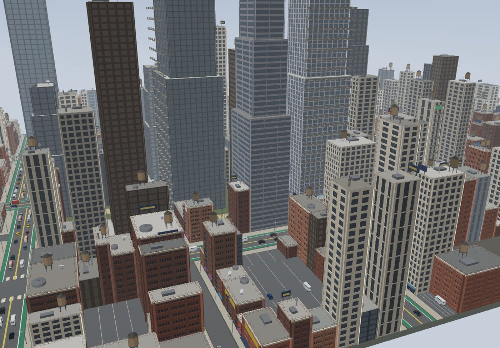

# Mojulo

**A 3D creative studio for your agent.** Make 3D objects, characters, environments, interactive worlds and even playable games, just by asking, and take them to your desktop: play them, print them, or open them in Godot, Unity, Unreal or Blender.



<sub>"Build a New York-style city at real scale."</sub>

You talk to the agent you already use: Claude Code, Codex, the Claude app, ChatGPT, or any MCP host. You bring the taste; it brings the craft. Change anything by asking, and everything that uses it changes too. No API key, no account, no telemetry.

## Get started

```bash
npx mojulo init
```

You need **Node.js 22.14+** ([nodejs.org](https://nodejs.org), or ask your agent to install it) and an agent that speaks MCP. `init` finds the agents on your machine (Claude Code, Codex, Claude Desktop and others), asks once for each, and opens the dashboard. Then start a fresh agent session and ask:

```
build a plywood chest of drawers, 900 wide, four drawers
a longsword, a shield and a bow
make me a hero in an anime style
a lake in the hills at sunset
here's our floor plan, some ideas for living in it?
build a New York-style city at real scale
make me a kart racer
what is this?
```

In ChatGPT, mojulo is also available as a plugin: [Mojulo for ChatGPT](https://github.com/zombico/mojulo/tree/main/plugins/mojulo-chatgpt).

Nothing on your machine at all? In the Claude app, Grok chat, Google AI Studio or Meta Muse, tell the agent: *Open a Linux box and install the mojulo npm package in it.* In ChatGPT, say the same in work mode. Ask for the bundle on the way out (one zip with the playable page, the 3D model, a print file and the recipe) and keep it: the recipe rebuilds the same thing on your own machine. A box with no MCP client: tell the agent to run `npx mojulo orient` first.

<details>
<summary>Wire it by hand</summary>

```bash
# Claude Code:
claude mcp add --scope user mojulo -- npx -y mojulo

# Codex CLI: add to ~/.codex/config.toml
[mcp_servers.mojulo]
command = "npx"
args = ["-y", "mojulo"]

# Claude Desktop: add under "mcpServers" in claude_desktop_config.json, then restart it
"mojulo": { "command": "npx", "args": ["-y", "mojulo"] }

# Claude Code on the web, a Codex cloud task: no one at the keyboard
npx -y mojulo init --yes --no-ui
```

Other MCP hosts: register the same `npx -y mojulo` stdio command.

</details>

## What you can make

Start small and go as far as you like.

- **3D objects.** Anything you can describe, at its real size, down to the pieces it is made of: a chest of drawers you can build, with its cut list, hardware list and assembly order; a bracket for your shelf; a Raspberry Pi case. Print it at true size as STL or 3MF.
- **Game items.** Swords, staffs, shields and bows in a historical, elven or dwarven style; handguns, rifles and knives, modern or from the future; karts, supercars, aircraft, boats, trains and walking mecha; the props that fill a level.
- **Characters.** Heroes in a realistic, cartoon or anime look, with faces that act; hair, clothes, armour, shoes and gear fitted to the body; animals mid-stride. Rigged and animated, ready for a game or for your 3D tools.
- **Environments and levels.** Your house from a picture of its floor plan, built to the inch, each room designed with furniture at true size. A facility of several levels, a hangar, barracks, an armoury and a reactor plant each in its own materials, planned first (the way through it and every level's walls, floors and light) and built only when you approve the plan. Terrain from a sentence, with its hills, rock, water, grass and trees, in the painted look of a sixth-generation console game or the grass, leaves and textured rock of a seventh. A dungeon, a historic city in its period, cities at real scale in the style of New York, Paris, London or Tokyo.
- **Interactive worlds.** Worlds you walk in the browser, with destructible environments: buildings, walls, trees and ground that break by what they are made of and fall under their own weight. Music and sound made from scratch, and flythroughs and cutscenes with actors who play a role from a script.
- **Playable games.** Stealth, racing, shooters, flight, fighting, rhythm, sports, board and strategy games, a pen-and-paper RPG; enemies from grunts to a boss; two to four players on one screen. You approve the plan first, and every level is played through to its win before you get it.

## Take it with you

- **Play it** in the browser, as a game folder for any web host, or as a desktop app that runs offline.
- **Open it in your engine:** a Godot 4, Unity 6, Unreal 5 or Blender project with each level's materials, light, markers and cameras. Hand it over again after a change and your team's own work in the scene is kept.
- **Use it in 3D tools:** `.glb` with rigs and animation, and OpenUSD, at true scale.
- **Print it:** STL or 3MF at true size in millimetres, ready for your slicer.
- **Watch and hear it:** flythroughs, turntables and films as video; music and sound effects as audio.

Every export says plainly what did not make the trip. Whether it looks good is your call: nothing in mojulo claims a person has looked.

## Where it runs

On your machine (macOS, Windows, Linux) you get everything: the dashboard, your work kept under `~/.mojulo/`, and any Blender, slicer, OpenSCAD or game engine you have, picked up automatically. In a chat app's Linux box nothing touches your machine; keep the bundle.

Where it has been run.  keeps your work ·  a throwaway box (keep the bundle). Blank means not verified yet, not "does not work".

| agent | macOS | Windows | Web agent's Linux box |
|---|:-:|:-:|:-:|
| Claude Code |  |  | |
| Claude app (macOS, Windows, web, iOS) |  |  |  |
| ChatGPT (work mode; Codex) |  Codex | |  |
| Hermes Agent |  | | |
| Grok (Build; chat) |  Build | |  |
| Meta Muse (iOS, web, macOS app; one session across them) | | |  |
| Google AI Studio | | |  |

**Upgrading from 2.x?** Read [Upgrading from 2.x](https://github.com/zombico/mojulo/blob/main/control/CHANGELOG.md#upgrading-from-2x) first: an unpinned `npx mojulo` moves to 3.x on its next start, and 3.x re-encrypts saved provider keys so 2.x can no longer read them. The 2.x versions are unmaintained and have known security issues ([SECURITY.md](https://github.com/zombico/mojulo/blob/main/SECURITY.md#known-issues-in-2x)).

## Dashboard

```bash
npx -y mojulo-ui                # opens in your browser
npx -y mojulo-ui --port 3999    # pin the port
npx -y mojulo-ui --no-open      # don't open the browser
```

Browse everything you have made, walk your worlds, play your games in the Arcade, and review films, music and voices. You make things by asking your agent; the dashboard shows them. It ships in every language under `messages/`, right-to-left scripts included (**Settings → Language**).

## Command line

The same `mojulo` command also works without an agent, for spot checks and scripts:

```bash
npx mojulo tools                      # what it can do
npx mojulo help export_model          # one tool's description and inputs
npx mojulo call version               # run any tool
```

## Your work stays yours

Everything lives on your machine in `~/.mojulo/`, and exports are plain files you open in anything. Ask to save something and it goes into your own cookbook, a local folder you can search later by describing what you made. Nothing is sent to the maintainer or to an analytics service ([what touches the network](https://github.com/zombico/mojulo/blob/main/docs/tech-requirements.md#network-posture)). It is for one person on their own machine, reachable only from localhost. Shared recipes can carry code: treat one from someone else like code.

What you make today rebuilds the same tomorrow: new releases add to what mojulo can make and never change what you already made. See the [changelog](https://github.com/zombico/mojulo/blob/main/control/CHANGELOG.md).

## More

- Full repo and docs: <https://github.com/zombico/mojulo>
- What it needs: [docs/tech-requirements.md](https://github.com/zombico/mojulo/blob/main/docs/tech-requirements.md)
- Terms: [TERMS.md](https://github.com/zombico/mojulo/blob/main/TERMS.md), [docs/responsibility-model.md](https://github.com/zombico/mojulo/blob/main/docs/responsibility-model.md)

## License

[Apache License 2.0](https://github.com/zombico/mojulo/blob/main/LICENSE). The name is a trademark: fork freely, under your own name ([TRADEMARKS.md](https://github.com/zombico/mojulo/blob/main/TRADEMARKS.md)).
